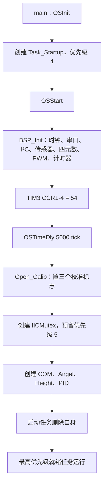
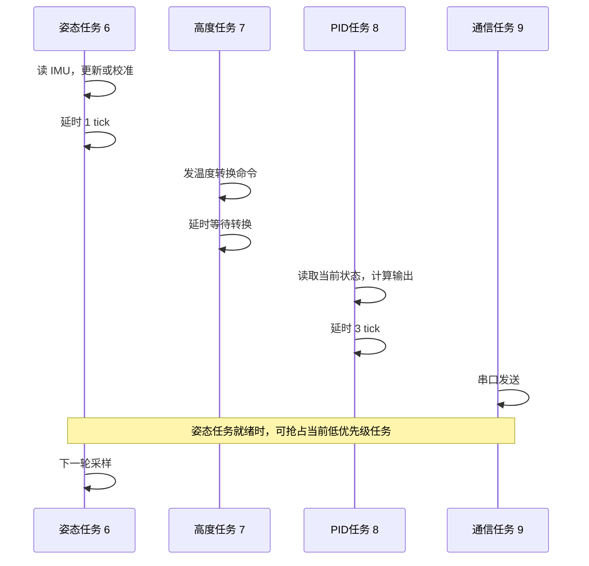

# 01 工程基线、任务安排与同步

本章目标：先明确“谁写数据、谁读数据、何时允许控制”，再实现姿态与 PID。前置条件是驱动和 OS 已能正常运行，电机动力电源断开。

## 1. 当前到底实现了什么

| 内容 | 当前事实 | 学习时的处理 |
|---|---|---|
| 采样 | `GY86_Read` 读取 MPU6050、HMC5883L、MS5611 | 保留驱动，但补有效性、时间戳与校准边界 |
| 四元数 | `IMU.c` 已有四个全局分量、初始化及积分 | 分阶段重新实现并对照 |
| 融合 | `Attitude_Update` 采用叉乘误差与 PI 修正 | 本指南沿用此 Mahony 风格结构 |
| roll/pitch PID | `Motor_Calc` 已调用串级计算 | 先隔离内环，再接外环 |
| yaw PID | 调用行被注释 | 在软件和无桨符号验证后再接通 |
| 高度 | 初始化 MS5611 被注释，任务仍被创建 | 不作为主线，先解除对姿态启动的依赖 |
| 安全 | 低油门及角度超限时设最低 PWM | 尚缺失联、数据过期、异常数值、解锁和 PID 复位 |

相关源码：[main.c](../../Project/APP/main.c)、[BSP.c](../../Project/BSP_SELF/BSP.c)、[IMU.c](../../Project/APP_FUNC/IMU.c)、[pid.c](../../Project/APP_FUNC/pid.c)。

## 2. 上电以后发生什么



`Quat_Init()` 在 `BSP_Init()` 中调用，发生在等待 5 秒和零偏校准之前，不是“校准完成后初始化四元数”。它假设水平，并立即读取磁力计。后续改进应把有效姿态初始化与传感器准备状态衔接起来。

`OSTimeDly(5000)` 在当前 1000 tick/s 下约为 5 秒。启动任务睡眠期间普通功能任务还没有创建，不能误认为这 5 秒里已在后台采集校准。

启动任务优先级 4 高于新建任务，创建期间它们不会抢占启动任务；删除自身之后，姿态任务 6 优先运行，但第一次 I²C 获取通常无竞争，之后的切换取决于就绪、等待和中断。

## 3. 谁在什么时候运行

| 任务 | 优先级 | 运行内容 | 阻塞/让出 CPU 的位置 |
|---|---:|---|---|
| Startup | 4 | 初始化、最低电机命令、创建对象与任务 | `OSTimeDly(5000)`，最后自删除 |
| Angel | 6 | 读取九轴；校准结束后更新姿态 | I²C 锁等待；轮末 `OSTimeDly(1)` |
| Height | 7 | 温度和气压转换；校准结束后计算高度 | I²C 锁等待、内部四次 `OSTimeDly(9)`、轮末 `OSTimeDly(1)` |
| PID | 8 | 遥控目标；校准结束后 PID、混控和输出 | 轮末 `OSTimeDly(3)` |
| COM | 9 | 打包并发送遥测 | 当前串口逐字节忙等；轮末 `OSTimeDly(10)` |

数字越小优先级越高。优先级 5 不是普通任务，而是 I²C 互斥锁的优先级提升预留项。

### 3.1 不能把延时当作精确周期

SysTick 在 [中断文件](../../Project/BSP_SELF/stm32f4xx_it.c#L131-L142) 中调用 `OSTimeTick()`，更新任务延时并在中断退出时处理调度。`OS_TICKS_PER_SEC=1000`。

`OSTimeDly(n)` 是相对于 OS tick 的阻塞，不是“固定每 n 毫秒启动”。任务执行耗时、调用时的 tick 相位、抢占和互斥等待都会影响周期。尤其调用 `OSTimeDly(1)` 时，可能很快遇到下一个 tick，也可能接近 1 ms。

高度转换调用链在 [GY86.c](../../Project/APP_FUNC/GY86.c#L130-L177)：温度转换等待 9 tick、温度函数额外等待 9 tick、压力转换等待 9 tick、压力函数额外等待 9 tick。因此不能把它称为 1 kHz 高度任务，也不能把四次等待严格等同于已测量的 36 ms 周期。

例如，下面是可发生的逻辑顺序，不是精确时间表：



### 3.2 当前串口发送不是真正异步

`USART_IT_EN=0` 选择轮询发送；`USART6_NItSend()` 忙等 TC，任务仍处于运行/就绪状态，不是 OS 阻塞状态。高优先级任务可以抢占它，但它会消耗剩余 CPU。

即使改成 `USART_IT_EN=1`，现有 `USART6_ItSend()` 也忙等 `FLAG_TC`，不是“提交缓冲区后马上返回”。本阶段不必重写串口 DMA，只需要降低发送量并且只让 COM 任务拥有发送接口与 `sendBuf`。

## 4. 当前同步机制的作用与缺口

### 4.1 I²C 互斥锁

`OSMutexPend(IICMutex, 0, &err)` 获取锁，参数 0 表示无限期等待；`OSMutexPost()` 释放。

互斥锁保护一次总线事务，避免姿态和高度任务同时操作 SDA/SCL。低优先级高度任务持锁时，姿态任务等待锁可能使持锁者提升到预留优先级 5，减轻优先级反转。它不是加速传感器转换，也不能解决代码永久不释放锁的问题。

要求：

1. 检查锁创建与获取的 `err`，只有成功获取后才操作总线。
2. 无论读成功还是失败，都释放已经获得的锁。
3. 等待气压转换期间不持锁，当前驱动基本按这个原则执行。
4. 给读取失败计数和数据过期建立上层保护；仅无限期等待不够。

当前 `GY86_Read()` 将释放放在 `if (!i2cread(...))` 内。`i2cread()` 现在一直返回 0，暂时掩盖了错误路径；当你修好返回值以后，如果不同时修锁释放，读失败会把锁留住。

### 4.2 校准标志不是数据通知

`Calib_Status()` 返回 `accOffset | gyroOffset | pressOffset`。它只判断标志是否都清零，没有等待事件，没有证明已经发布首帧正确姿态。

更重要的是：`GY86_Read(ACC_GYRO_MAG)` 与 `GY86_Read(TEMP_PRESS)` 末尾都调用 `MPU6050_Offset()`。同一个函数内部的静态累加器可能被两个任务交错访问；可能重复统计旧气压或旧 IMU 样本，清除标志也不代表收集了规定数量的新样本。

**主线建议：姿态校准由姿态任务单独拥有，只在成功取得新 IMU 样本时累计；气压校准由高度任务独立处理。不使用高度功能时，不把 `pressOffset` 加进姿态/PID 的允许条件。**

### 4.3 全局变量不是整体同步

数据关系：

| 数据 | 当前主要写入者 | 当前读取者 |
|---|---|---|
| `acc/gyro/fGyro/mag` | 姿态任务 | 姿态计算、PID、COM、校准函数 |
| `q0-q3/angle` | 初始化阶段、之后姿态任务 | 姿态计算、PID、COM |
| `pressure/height` | 高度任务 | 高度计算、COM、校准函数 |
| `PWM_IN_CH` | TIM5 ISR | PID、COM |
| 期望、PID 状态、电机命令 | PID 任务 | COM、PWM 输出 |

PID 在读取某个角度后可能被姿态任务抢占，恢复后再读到下一帧角速度。一组变量就混合了两帧。`volatile` 最多约束编译器访问，不提供整体一致性，也不代表样本是新的。

## 5. 推荐的任务安排：先保留结构，补上边界

本指南第一版不要求新增采样任务，保留“姿态任务自己读 IMU 并解算”的结构：

| 阶段 | 姿态任务 | PID 任务 | COM | 高度 |
|---|---|---|---|---|
| 驱动验收 | 发布传感器样本和时间 | 不输出动力 | 发原始值与错误计数 | 暂不创建或不参与主线 |
| 校准 | 只累计新的有效样本 | 安全命令，重置 PID | 发校准进度 | 若保留，独立校准 |
| 姿态开发 | 解算并发布快照 | 只做影子计算，禁止输出 | 发姿态与计时统计 | 不影响姿态允许条件 |
| PID 开发 | 持续发布快照 | 验证输入、计算并记录 | 发内外环与混控结果 | 仍不启用定高 |
| 无桨输出验收 | 同上 | 满足安全条件后低风险输出 | 低频统计 | 可保持禁用 |

优先级先保持姿态 6、PID 8、COM 9；高度若启用仍为 7。是否调整频率或优先级，要以实际执行耗时、数据新鲜度和截止期测量为依据。

开始可保留现有延时参数，但称为“名义调度间隔”，不要声称已经实现 1 kHz/333 Hz 精确闭环。姿态和 PID 分别测 `dt`；PID 的积分时间不能拿姿态 `dt` 代替。

## 6. 用短临界区发布状态快照

建议在 `IMU.h` 中增加状态类型，在 `IMU.c` 中定义唯一的共享对象。下面是接口示例，字段单位明确：

```c
typedef struct {
    Angle_t angle_deg;
    Float_t gyro_rad_s;
    uint32_t sample_us;
    uint32_t sequence;
    uint8_t valid;
} AttitudeSnapshot;

static AttitudeSnapshot shared_attitude;

void Attitude_Publish(const AttitudeSnapshot *next)
{
    OS_CPU_SR cpu_sr;
    OS_ENTER_CRITICAL();
    shared_attitude = *next;
    OS_EXIT_CRITICAL();
}

void Attitude_Copy(AttitudeSnapshot *out)
{
    OS_CPU_SR cpu_sr;
    OS_ENTER_CRITICAL();
    *out = shared_attitude;
    OS_EXIT_CRITICAL();
}
```

当前端口采用 `OS_CRITICAL_METHOD=3`，每个使用这些宏的函数都声明自己的 `OS_CPU_SR cpu_sr`。在临界区里只能做短复制，不能读 I²C、算三角函数、发串口、延时或获取 OS 互斥锁。

具体接入步骤：

1. 姿态任务把本轮输入和计算结果保存在局部变量，不让 `valid` 提前变成 1。
2. 校准未完成、首帧未初始化、采样失败时发布无效状态；必要时保留上次姿态但不得伪造新时间戳。
3. 成功解算后填入同轮 `angle`、`gyro`、真实采样时间、递增序号，最后发布。
4. PID 先复制一次，整个本轮只使用局部副本；不再直接读零散全局量。
5. COM 同样复制后再编码发送。PID 的期望、输出、电机命令也发布为独立控制快照。
6. PID 在校准、无效、过期、未解锁时走安全输出并复位；“跳过计算后保留旧 PWM”不是安全策略。

读取 `PWM_IN_CH` 也要短临界区复制四通道及各自最近更新时间。四通道 PWM 不一定同时到达；快照保证不被 ISR 改到一半，时间戳用于判断每一路是否仍有效。

## 7. 是否需要信号量

第一版采用“周期 PID + 快照 + 新鲜度检测”即可，不要求立即增加通知机制。

如果以后要求“每个有效姿态样本驱动一次 PID”，可以用信号量，但 [os_cfg.h](../../Project/APP/os_cfg.h) 当前 `OS_SEM_EN=0`，必须先启用并重新构建内核。

通知策略需明确：

1. 姿态发布快照后通知，PID 等待带有限超时的通知。
2. 超时必须执行安全输出，不能无限期停在等待中让电机保持旧命令。
3. 信号量计数不会自动与一个可覆盖的共享快照逐帧对应；不要积压很多计数再重复算同一帧。
4. 本工程通常选择“消费最新状态”，合并旧通知，按真实更新时刻计算控制 `dt`。
5. 不要用高优先级忙等读取序号，会阻止低优先级生产者完成发布。

当前 TIM5/USART ISR 中的 `OSIntEnter/OSIntExit` 是注释状态。它们目前没有发 OS 通知；如果以后在 ISR 中调用内核 API，需按本端口的中断入口/退出规范和中断优先级重新核对，不能直接往原 ISR 添加 `OSSemPost` 就结束。

## 8. 计时器先修清楚

| 用途 | 当前配置 | 风险 |
|---|---|---|
| AHRS TIM2 | PSC=83，ARR=65535，返回 CNT/2000000 | 硬件 TIM2 为 32 位，但当前只配置 16 位周期；假定 1 MHz 时约 65.536 ms 回绕 |
| PID TIM4 | PSC=79，ARR=65535，返回 CNT/1000000 | 定时器为 84 MHz 时实际计数 1.05 MHz，时间报告偏大约 5% |

两者每次读取 CNT 后清零，读与清零间会丢失少量时间；初始化后又等待 5 秒和校准，第一次测出的周期更不能当作正常周期。

动手顺序：

1. 用 RCC 配置核对实际 APB1 定时器时钟；常见配置是 PCLK1=42 MHz、定时器=84 MHz，不只看注释。
2. 正常计时频率若选 1 MHz，使预分频与除数配套。
3. 第一次有效更新只建立计时基准，不积分或微分。
4. 优先改为自由运行 TIM2 的 32 位时间戳；配置完整 ARR，并核对所用库初始化字段可承载完整值，不能仅把局部变量改成 `uint32_t`。
5. 读取 `now_us`，无符号差分 `elapsed_us = now_us - last_us` 处理一次 32 位回绕；1 MHz 下约 71.6 分钟回绕。必须假设两次有效测量间隔小于一整圈。
6. `dt=elapsed_us*1e-6f`，检验本机允许范围。异常时保持禁止控制，复位时间历史，不把大间隔截成小值后假装正常。

## 9. 本章验收

- [ ] 画出当前与建议的数据所有权，能解释锁只保护什么。
- [ ] 姿态/PID 允许条件不再依赖未验证的气压校准。
- [ ] 校准统计只由一个任务拥有，且仅统计新有效样本。
- [ ] 记录姿态与 PID 实际间隔的最小、平均、最大值和异常次数。
- [ ] 开启/关闭遥测、保留/关闭高度任务时，分别测量周期变化。
- [ ] 快照序号递增，PID 检查有效性和年龄，不能读取混合字段。
- [ ] 所有学习阶段都默认禁止动力输出。

下一章：[传感器预处理](02_传感器预处理.md)。
