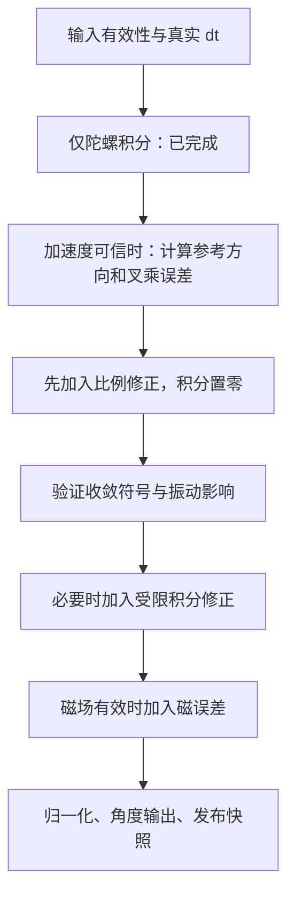
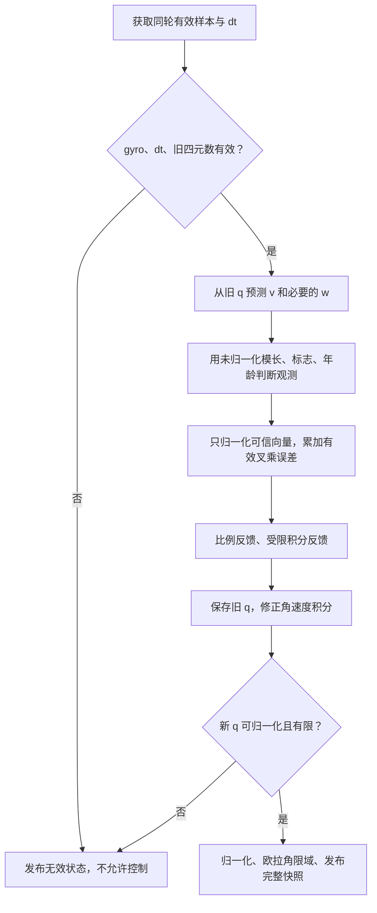

# 04 姿态融合：给四元数预测加入可靠反馈

本章目标：沿 [Attitude_Update](../../Project/APP_FUNC/IMU.c#L251-L342) 实现“陀螺预测 + 方向误差 PI 修正”。前置：纯陀螺四元数的单位、时间和符号测试通过，仍禁止动力输出。

## 1. 先区分两个 PI/PID

| 算法 | 误差 | 输出 |
|---|---|---|
| 姿态融合中的 `Kp/Ki` | 预测方向与观测方向的差异 | 修正陀螺角速度，再更新四元数 |
| `pid.c` 的控制 PID | 目标姿态/角速度与实际值差异 | 四电机命令差分 |

融合不直接控制电机，控制 PID 也不负责修正四元数。参数名相似但量纲、作用完全不同。

《姿态解算.pdf》主要介绍 Madgwick 梯度下降。当前源码采用 `a×v + m×w` 叉乘误差、PI 反馈，所以本指南称为 Mahony 风格反馈融合；不要求实现 Jacobian 或 Madgwick。

## 2. 推荐实现顺序



第一版先完成六轴，不用磁场也能让 roll/pitch 收敛；yaw 漂移是六轴不可观测方向，不是漏写了一行 `asin`。

## 3. 从四元数预测参考方向

沿用上一章的 `q_NB`。源码用导航参考 `v_N=(0,0,1)`，转回算法机体系：

\[
v_B=R(q)^Tv_N=
\begin{bmatrix}
2(q_1q_3-q_0q_2)\\
2(q_0q_1+q_2q_3)\\
q_0^2-q_1^2-q_2^2+q_3^2
\end{bmatrix}
\]

就是代码里的 `vx,vy,vz`。不要把这段注释理解为“用加速度积分得到了速度”，它是在预测静态参考方向。

当 `q=(1,0,0,0)`，预测 `(0,0,1)`；所以本版本要求归一化静止加速度在水平时也为 `(0,0,1)`。若驱动轴向与此不符，必须先配套映射，而不是翻转反馈号碰碰运气。

比力与重力的物理符号取决于坐标约定。这里为了匹配源码使用 +z 静态观测参考，不把它直接等同于标准 NED 的重力加速度；标准 NED/FRD 下静止原始比力为 -z，两套不能混用。

## 4. 加速度误差与比例反馈

归一化可信加速度为 `a=(ax,ay,az)`：

\[
e_a=a\times v,\quad
\begin{cases}
e_x=a_yv_z-a_zv_y\\
e_y=a_zv_x-a_xv_z\\
e_z=a_xv_y-a_yv_x
\end{cases}
\]

然后：

\[
\omega_{corr}=\omega_{meas}+K_p e_a
\]

再把修正角速度送入第 3 章积分。这是把方向误差作为角速度反馈，不是直接把欧拉角拉回零。

### 4.1 用一组数验证是负反馈

真实水平，观测 `a=(0,0,1)`；当前估计错误地绕算法 x 轴 +10 度：

\[
q=(\cos5^\circ,\sin5^\circ,0,0),\quad
v=(0,\sin10^\circ,\cos10^\circ)
\]

得到：

\[
e_a=(-\sin10^\circ,0,0)
\]

`Kp>0` 时修正 `gx` 为负，估计 x 角减小，回到正确水平。这是最重要的收敛符号测试。

### 4.2 源码条件必须处理

当前：

```c
if (ex != 0.0f && ey != 0.0f && ez != 0.0f) {
    /* correction */
}
```

上述例子 `ey=ez=0`，整个修正恰好被跳过。因此不能继续保留“三个轴都非零”条件。

建议基于观测有效性决定是否更新反馈；三个分量分别正常参与，包括零分量。误差为零时比例项为零即可。若积分代表之前估出的角速度偏置，即使本次方向误差为零，也不应仅因为误差范数为零而突然丢弃有效历史补偿。

## 5. 积分反馈及量纲

\[
I_{k+1}=I_k+K_i e_k dt,\qquad
\omega_{corr}=\omega_{meas}+K_p e_k+I_{k+1}
\]

归一化叉乘误差近似无量纲，`Kp*e` 和积分状态都必须是 rad/s。这里 Ki 对应约 rad/s² 的反馈增益，和飞行控制 PID 的积分增益不是同一个量。

源码用 `ex*Ki*halfT`，而 `halfT=dt/2`。四元数微分需要半周期，但方向误差积分按完整 `dt` 累计；若把代码改成完整 `dt`，相同 Ki 会变成原先约两倍的积分作用，需重新调试，不能说“修公式后参数完全不变”。

动手步骤：

1. 首先 `Ki=0`，只验证比例反馈能正确收敛。
2. 记录长期静止偏差，确有需求后再加小的积分反馈。
3. 对积分状态设置量纲明确的 rad/s 限幅。
4. 大加速度或磁干扰期间冻结不可信误差的积分，避免把运动误差长期吸收为零偏。
5. 初始化/重新校准时复位积分；单次观测掉线不需要把姿态强制重置为水平。

## 6. 对观测进行门控

先用未归一化加速度判断可信度，再归一化：

\[
a_g=a_{raw}/8192,\quad n_a=\|a_g\|
\]

静止 `n_a≈1`，明显偏离 1 时应降低/关闭加速度校正。这只是必要检查，不是充分证据；某些动态加速度模长也可能接近 1。

`n_a=0`、无效读数或非有限值时，不能计算 `1/sqrt(n_a²)`。若 gyro 和时间仍有效，可继续纯陀螺短期预测，但应标记降级模式；若必需输入失效/长期过期，控制端禁止输出。

不要在每次加速度门控失败时把整个 AHRS `return`，否则有效陀螺预测也停止，姿态会冻结。

| 情况 | 姿态更新建议 | 控制建议 |
|---|---|---|
| IMU 成功、acc/gyro可信 | 正常六轴/九轴 | 其他条件满足后可用 |
| gyro可信、acc受动态干扰 | 短时纯陀螺预测，冻结相应积分 | 按持续时间和安全策略评估 |
| mag失效或干扰 | 保留六轴，不重置四元数 | 不宣称航向稳定，yaw速率仍可有反馈 |
| IMU读取失败、时间异常、数值无效 | 标记无效，重建必要历史 | 安全输出与PID复位 |

## 7. 加入源码的磁场分支

### 7.1 它在算什么

源码先归一化 `m_B`，再算：

\[
h_N=R(q)m_B,\quad
b_y=\sqrt{h_x^2+h_y^2},\quad b_z=h_z
\]

将磁场水平参考设在 +y：

\[
b_N=(0,b_y,b_z),\qquad w_B=R(q)^Tb_N
\]

对应 `hx/hy/hz → by/bz → wx/wy/wz`。`by` 不是北向实测值，而是构造的水平参考强度。

现有展开：

\[
\begin{aligned}
w_x&=2b_y(q_1q_2+q_0q_3)+2b_z(q_1q_3-q_0q_2)\\
w_y&=2b_y(0.5-q_1^2-q_3^2)+2b_z(q_0q_1+q_2q_3)\\
w_z&=2b_y(q_2q_3-q_0q_1)+2b_z(0.5-q_1^2-q_2^2)
\end{aligned}
\]

磁误差 `e_m=m×w`，与加速度误差相加：

\[
e=w_a e_a+w_m e_m
\]

现有代码相当于同时有效时 `wa=wm=1`。后续可先采用 0/1 门控，避免引入复杂自适应算法。

讲义常把水平参考放在 +x，源码放在 +y；直接复制讲义 `bx` 公式替换 `by`，而不改初始化和参考方向，会造成航向偏差或修正不一致。

### 7.2 航向符号和初始化要联测

源码水平 `Quat_Init` 使用 `atan2(mx,my)`，磁反馈的 `R/R^T` 与四元数 yaw 定义也必须一起核对。不能仅凭同样出现 `atan2` 就认定符号正确。

做合成测试：选一个已知 `q_true`，设 `b_N=(0,0.8,0.6)`，生成 `m_B=R(q_true)^T b_N`，然后：

1. 当估计等于 `q_true`，`m×w` 应接近零。
2. 估计 yaw 轻微偏离真实值，迭代后误差应减小。
3. 把合成 `m_B` 送到初始化逻辑，得到的 yaw 应与更新分支的参考定义一致。

例如真实纯 yaw=+30 度时，该模型产生 `mx=+0.4,my≈0.6928,mz=0.6`，`atan2(mx,my)=+30`，并应形成零磁误差。再上板验证安装映射，不能跳过物理轴检查。

### 7.3 如何处理较慢的磁采样

两种可行策略必须选定并解释：

- 第一版：只在新的有效磁样本到达时加入磁误差，其余周期六轴；磁积分按实际启用时刻和所选增益语义设计，记录修正频率。
- 后续：保持上次磁观测并显式按观测保持模型使用，同时记录样本年龄，过期就关闭磁项。

本指南推荐先使用第一种便于验证；由于修正仅在较低频率参与，相同数值的磁增益不等价于每个 IMU 周期参与，必须以收敛数据重新调试。

不要在读取旧磁数据时增加“新磁序号”，也不要为重复数据伪造新时间戳。

## 8. 建议更新函数的内部顺序

以下是设计顺序，不是完整的替换代码：



门控、误差和四元数参考计算使用同一个旧 q；别在算完一部分误差时先更新 q，再用新 q 算另一部分。

## 9. 分阶段验收与调参

| 实验 | 操作 | 应观察到 |
|---|---|---|
| 静止正确状态 | 单位 q、`a=(0,0,1)`、gyro=0 | 加速度误差为零，姿态保持 |
| 单轴估计偏差 | 合成 +10 度错误 q，真实水平 | 只有一个误差轴也能收敛 |
| 六轴长时静置 | 禁用磁反馈，记录 60 秒 | roll/pitch稳定；yaw仍可能漂移 |
| 慢速单轴转动 | ±30/±60 度，转后静置 | 方向正确，转后能稳定 |
| 动态加速度 | 安全地轻微平移控制板 | 门控变化可解释，不出现 NaN |
| 磁合成数据 | 已知 q 和参考磁场 | 零误差及偏差收敛通过 |
| 磁异常 | 软件关闭 mag_valid | 平滑进入六轴，不重置姿态 |

Kp 增大通常使方向校正更快，也更容易引入噪声与动态加速度错误。不要用更大 Kp 补偿错误 `dt`、错轴或过低 DLPF 带宽带来的延迟。

验收记录：四元数范数、姿态静止变化、方向误差范数、加速度门控比例、磁新样本间隔、实际更新 `dt`。门限和允许误差需根据传感器噪声与参照工具设置，不能把演示数据精度当硬件精度。

下一章：[串级 PID](05_串级PID.md)。
