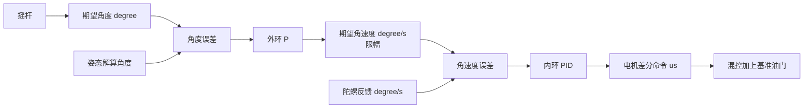

# 05 串级 PID：先速率，后姿态

本章目标：沿 [pid.c](../../Project/APP_FUNC/pid.c) 实现可检查的 roll/pitch 双环，并理解 yaw 速率环。前置：姿态快照、角速度反馈、采样时间可靠；仍先影子计算，禁止输出动力。

参考资料：《PID》第 4-9 页，《PID 控制算法简述》第 9-10、13 页。

## 1. 把闭环信号分清楚



外环输出不是电机 PWM，也不是下一时刻角度，而是内环角速度目标。

现有调用：

```c
pidRoll = PID_Calc(expRoll - angle.roll,
                  fGyro.y * RAD_TO_ANGLE, &rollShell, &rollCore);
pidPitch = PID_Calc(expPitch - angle.pitch,
                   -fGyro.x * RAD_TO_ANGLE, &pitchShell, &pitchCore);
```

这两行既定义了单位，也定义了轴映射。建议通过 `Attitude_Copy()` 取完整快照后，计算：

- `roll_rate_deg_s = snapshot.gyro_rad_s.y * RAD_TO_ANGLE`
- `pitch_rate_deg_s = -snapshot.gyro_rad_s.x * RAD_TO_ANGLE`
- `yaw_rate_deg_s = snapshot.gyro_rad_s.z * RAD_TO_ANGLE`

陀螺给的是机体角速度，通常不严格等于欧拉角导数。现有用法针对小倾角姿态稳定；不要据此宣称大角度、任意姿态下各欧拉角速率都等于对应 gyro 分量。

## 2. 理解当前结构与参数

[pid.h](../../Project/APP_FUNC/pid.h) 中 `PID_t`：

| 字段 | 当前用途 |
|---|---|
| `eK` | 本次误差 |
| `eK_1` | 上次误差，用于差分 |
| `eSum` | 未乘时间的误差和 |
| `Kp` | 比例增益 |
| `Ti` | 积分时间常数 |
| `Td` | 微分时间常数 |
| `output` | 限幅后的环输出 |

`PID_Calc()` 用空指针组合区分分支：

| shell/core | 当前功能 |
|---|---|
| 两者都有 | 角度外环 P + 速率内环 PID |
| 只有 shell | 高度分支，实际为 P+D，不在本次主线 |
| 只有 core | yaw 速率 P+D，内部使用全局 `expYaw` |
| 两者没有 | 返回 0 |

C 中字面量 0 可作为空指针常量，使用 `NULL` 更便于阅读；问题不在这里，而在一个函数用全局量和空指针承担多种语义。学习时可先保留框架，但把“角度外环输出”和“独立速率目标”分别写清楚。

## 3. 从连续到离散

\[
u(t)=K_p e(t)+K_i\int e(t)dt+K_d\frac{de(t)}{dt}
\]

直接用 `Kp,Ki,Kd` 时：

\[
I_k=I_{k-1}+e_k dt_k,\quad
D_k=(e_k-e_{k-1})/dt_k,\quad
u_k=K_p e_k+K_i I_k+K_d D_k
\]

源码用：

\[
K_i=K_p/T_i,\qquad K_d=K_pT_d
\]

于是固定周期下：

\[
u_k=K_p\left(e_k+\frac{dt}{T_i}\sum e_j+
\frac{T_d}{dt}(e_k-e_{k-1})\right)
\]

这对应 `coreKi=pidT/Ti`、`coreKd=Td/pidT`，再整体乘 `Kp`。`coreKi` 变量不是连续积分增益，只是本次离散积分比例。

**当前 `eSum` 写法只在周期基本固定时近似合理。** 当 `pidT` 变化时，代码以“本次 dt”乘整个历史误差和，相当于重加权了过去的积分。推荐直接累计 `e*dt`，不在输出端重新乘本次 dt。

量纲：

| 环 | Kp 量纲 | 积分/微分意义 |
|---|---|---|
| 角度外环 | `(degree/s)/degree=1/s` | 当前只有 P |
| 速率内环 | `us/(degree/s)` | Ki、Kd 分别配积分误差和角速度变化 |

把内环从 degree/s 改为 rad/s 而保持同一个输出，增益要按单位重新换算，不能原样复制。

## 4. 第一阶段：只做独立速率 P

不要一开始把两环都开起来调。

动手：

1. 获取有效状态快照，安全条件不满足时不计算控制并复位历史。
2. 选 roll 单轴，直接给小范围软件 `rate_ref_deg_s`，暂不使用 `expRoll-angle.roll`。
3. `error=rate_ref-roll_rate`，`u=Kp*error`。
4. 限制输出，记录 `rate_ref,rate,error,u`；电机输出仍禁用。
5. 对静止反馈、正负反馈、设定值阶跃进行软件测试。

手算：`ref=20 degree/s`、`meas=5 degree/s`、演示 `Kp=2 us/(degree/s)`，输出 +30 us；反馈变成 25 时输出 -10 us。这个数值只用于计算检查。

机械闭环调参需要带推力的可靠试验装置；无桨模式只能验证电机命令符号，不能证明速率环已稳定。不要手持有桨机体测试。

## 5. 第二阶段：增加积分和微分保护

### 5.1 积分怎么保存

推荐给 `PID_t` 增加或重新定义 `integral`，保存 `∫e dt`；如选择让 `eSum` 改作时间积分，必须同时修改输出公式，不能继续乘 `pidT/Ti`。

每轮先试算：

\[
I_{trial}=I_{old}+e\,dt,\quad
u_{raw}=K_p e+K_i I_{trial}+K_d D
\]

如果输出已超上限且误差还在往正方向推，或者超下限且误差还往负方向推，就不接受本次积分。然后用接受后的积分重新算输出并限幅。

建议同时：

- 限制积分贡献 `Ki*integral` 的最大 us，而不是给一个没有解释的误差和上限。
- 低油门、未解锁、校准、数据无效时冻结或复位；本教程优先复位。
- 混控后电机饱和时，把饱和状态反馈给积分管理；仅内环输出限幅还不是完整抗饱和。

当前 `CORE_INT_MAX` 只限制累加器趋势，没有检测执行器饱和；`CORE_INT_SEP_MAX` 定义了但未使用，不表示积分分离已实现。

### 5.2 微分为什么容易突然很大

对误差微分：

\[
D=(e_k-e_{k-1})/dt
\]

目标突然跳变会导致微分冲击。推荐改为测量微分：

\[
D_{raw}=-(y_k-y_{k-1})/dt
\]

设定值固定时两者等价；设定值变化时测量微分不会把目标跳变放大成 D 冲击。

再用一阶滤波：

\[
\alpha=dt/(\tau_d+dt),\quad
D_f\leftarrow D_f+\alpha(D_{raw}-D_f)
\]

`tau_d` 是微分滤波时间常数，不是 `Td`。滤波会带来延迟，应和传感器 DLPF 一起评估，不是越强越安全。

### 5.3 首次调用与复位

第一次有效调用把 `previous_measurement` 初始化为当前值，让 D=0。低油门/失联/数据异常时清除积分、微分滤波和初始化标志，下一次重新建立历史。

仅把 `motor1-4` 设为最低值而继续积累 PID，会在再次允许输出时带着旧积分启动。

## 6. 一个明确依赖的速率 PID 教学实现

以下代码使用通用 Kp/Ki/Kd 形式，是供你移植进 `pid.c/pid.h` 的教学模块，不是现有 API 的直接替换。`Float_IsFinite` 必须由实际 Keil/主机工具链提供；`dt_max`、积分贡献和输出限幅由本机测试设置。

```c
typedef struct {
    float kp, ki, kd;
    float integral, prev_y, d_filter;
    float tau_d, dt_max, i_limit;
    float u_min, u_max;
    uint8_t initialized;
} RatePid;

static float Clamp_Float(float x, float lo, float hi)
{
    return x < lo ? lo : (x > hi ? hi : x);
}

static void RatePid_Reset(RatePid *s)
{
    s->integral = 0.0f;
    s->prev_y = 0.0f;
    s->d_filter = 0.0f;
    s->initialized = 0;
}

/* Returns success; failure always produces a zero correction. */
int RatePid_Step(RatePid *s, float ref, float y, float dt,
                 uint8_t allow_integral, float *out)
{
    float e, d_raw, alpha, i_trial, u_trial, u;
    *out = 0.0f;
    if (!Float_IsFinite(ref) || !Float_IsFinite(y) ||
        !Float_IsFinite(dt) || dt <= 0.0f || dt > s->dt_max) {
        RatePid_Reset(s);
        return 0;
    }
    if (!s->initialized) {
        s->prev_y = y;
        s->initialized = 1;
    }
    e = ref - y;
    d_raw = -(y - s->prev_y) / dt;
    alpha = dt / (s->tau_d + dt);
    s->d_filter += alpha * (d_raw - s->d_filter);
    i_trial = s->integral;
    if (allow_integral && s->ki > 0.0f) {
        i_trial += e * dt;
        i_trial = Clamp_Float(i_trial, -s->i_limit / s->ki,
                             s->i_limit / s->ki);
    }
    u_trial = s->kp * e + s->ki * i_trial + s->kd * s->d_filter;
    if (!((u_trial > s->u_max && e > 0.0f) ||
          (u_trial < s->u_min && e < 0.0f))) {
        s->integral = i_trial;
    }
    u = s->kp * e + s->ki * s->integral + s->kd * s->d_filter;
    s->prev_y = y;
    if (!Float_IsFinite(u)) {
        RatePid_Reset(s);
        return 0;
    }
    *out = Clamp_Float(u, s->u_min, s->u_max);
    return 1;
}
```

调用前检查配置：各参数有限、`kp/ki/kd>=0`、`tau_d>=0`、`dt_max>0`、`i_limit>=0`、`u_min<u_max`。有 Ki 时假定其为正。`dt` 还要满足实际最小可用时间精度；极小合法正值也可能放大微分，不应绕过时间异常检查。

失败返回的 0 是“零姿态差分”，不是停机命令；上层必须检查返回值，走安全 PWM 路径。不能继续把正常基准油门加到失败输出上。

从原参数转换时：`kp=Kp`、`ki=Kp/Ti`、`kd=Kp*Td`。关闭积分应显式 `ki=0`；若沿用原函数，不能设 `Ti=0`，因为它会除零。

## 7. 第三阶段：接回角度外环 P

\[
rate_{ref}=K_{p,shell}(angle_{ref}-angle)
\]

先限制 `rate_ref`，再送入内环：

```c
rate_ref = Limit(shell_kp * (angle_ref - angle_measured),
                 -rate_limit, rate_limit);
```

当前外环没有此限幅；不应让大角度误差产生无限大的目标角速度。

例：角度误差 10 度、演示外环 Kp=4.4 1/s，目标速率 44 degree/s；内环测到 10 degree/s，误差 34 degree/s。

两环可以在同一个 PID 任务每轮计算。先让内环响应明显快于外环，再逐步增加外环 Kp；“内环带宽高于外环”不等于必须分成两个任务，也不等于现有 3 tick 延时已经满足带宽需求。

### 7.1 当前参数的冲击算例

现有内环 `Kp=2.6,Ti=0.5,Td=0.08`。假定首次 `dt=0.003 s`，外环给 44 degree/s，历史误差为零：

\[
coreKi=0.006,\quad coreKd≈26.6667
\]

\[
u≈2.6(44+44\cdot0.006+44\cdot26.6667)≈3165.75
\]

输出立即被限为 500。它说明为什么必须记录未限幅值和首帧历史，不能只看输出 500 就继续增益调参。这些现有参数不是本机稳定保证。

## 8. 接入遥控目标

现有 `Motor_Exp_Calc()`：

| 通道索引 | 目标 |
|---|---|
| `[3]` | `(PWM-1500)*0.03` → roll，实际 ±15 度，不是注释的 ±20 |
| `[1]` | `(PWM-1500)*0.04` → pitch，±20 度 |
| `[0]` | `(PWM-1500)*0.02` → yaw 速率，±10 degree/s |
| `[2]` | 直接作为 `expMode`，当前实际是油门基准脉宽 |

先检查原始输入有效性与更新时间，再限幅和映射。把坏数据限制到 1000-2000 不能检测失联；旧油门可能被永久保留。

实测中位不一定为 1500。记录中位与端点，加入合理死区和目标限幅，按实际遥控方向核对。遥控死区作用于输入，不应随意对姿态误差加大死区来掩盖振荡。

## 9. yaw 为什么不是第三套角度外环

当前 yaw 调用被注释。现有 `expYaw` 是 degree/s；yaw 分支实际为速率 PD，不是航向角 PID：

\[
e_{yaw}=yaw_{rate,ref}-gyro_z\cdot RAD\_TO\_ANGLE
\]

本指南沿用这个语义：摇杆回中意味着目标偏航速率为零，而不是自动回到零度航向。可以使用同一个独立速率模块，先 P，再按测量增加 I/D；不要求航向角外环。

roll/pitch 与电机方向验证通过后，再检查偏航差分、旋转方向和反馈符号。不要仅取消注释就宣布 yaw 完成。

## 10. PID 任务每轮执行顺序

1. 复制遥控与姿态快照，读取当前控制时间。
2. 检查校准、初始化、数据年龄、有限数、遥控有效性及解锁。
3. 不满足时统一安全输出、复位状态和控制计时历史。
4. 有效时计算真实控制 `dt`，首帧初始化历史。
5. 遥控映射得到 roll/pitch 角度、yaw 速率和基准油门。
6. 计算外环目标限幅，再计算三个速率环。
7. 有任一必需控制计算失败，进入安全输出。
8. 混控、输出限幅、安全复核；发布完整控制快照。

`pidT` 每轮测量一次，各轴用相同控制周期。若 PID 比传感器更新快，不能对同一测量反复当作新样本微分；定义好是否跳过重复序号，并保留定期安全检查。实际新鲜度阈值由测量周期与控制要求确定。

## 11. 验收与调参顺序

- [ ] 纯速率 P 的正负误差输出正确。
- [ ] Ki=0、Kd=0 可以真正关闭对应项，且不除零。
- [ ] 首帧测量微分为零；目标阶跃不出现人为 D 冲击。
- [ ] 恒定误差下积分随真实累计时间增长。
- [ ] 持续饱和不无界积分，解除后能恢复。
- [ ] 停机/失联后积分清零，重新允许时没有旧历史冲击。
- [ ] 内环软件验证后再接外环；先单轴 roll，再 pitch，再 yaw。
- [ ] 记录原始与限幅输出、P/I/D、目标和反馈、混控饱和。

无桨完成的是逻辑与输出验证；真正调参优先使用仿真或具备护罩、限位、急停的合规试验装置，再由有经验人员在受控条件下进行有桨验证。不以自由飞行中的持续振荡作为教程必做步骤。

下一章：[混控、安全与联调](06_混控安全与联调.md)。
