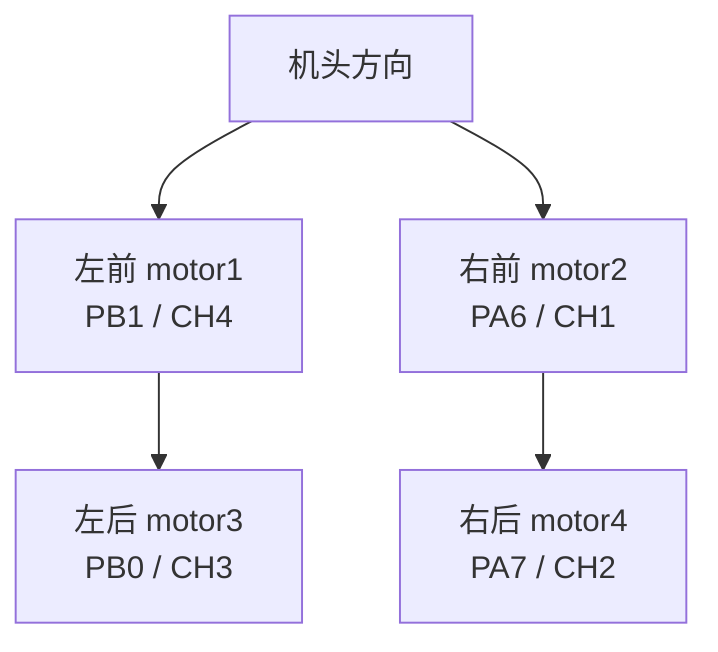
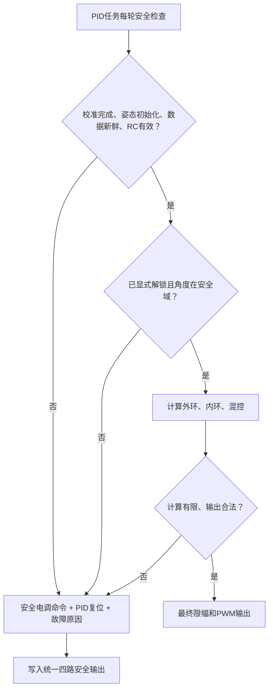

# 06 电机混控、安全输出与系统联调

本章目标：把已经验证的姿态与控制差分转换为正确、安全的电调命令。前置：姿态快照与 PID 软件验收通过。默认仍为影子计算；动力测试必须拆桨、限流/急停并明确电调行为。

源码：[Motor_Calc](../../Project/APP_FUNC/pid.c#L172-L220)、[pwm.c](../../Project/APP_FUNC/pwm.c)、[pwm.h](../../Project/APP_FUNC/pwm.h)、[引脚配置](../引脚配置.txt)。

## 1. 先分清电机编号和定时器通道

主文件注释和 `PWM_OUT()` 给出的组合：

| 逻辑电机 | 位置 | 源码标注转向 | 输出通道 | 引脚 |
|---|---|---|---|---|
| motor1 | 左前 | 顺时针 | TIM3_CH4 | PB1 |
| motor2 | 右前 | 逆时针 | TIM3_CH1 | PA6 |
| motor3 | 左后 | 逆时针 | TIM3_CH3 | PB0 |
| motor4 | 右后 | 顺时针 | TIM3_CH2 | PA7 |

顺/逆时针必须明确观察方向，例如统一“从机体上方向下看”。源码未写明观察方向，所以表中是代码标注，不是实测事实。



这是位置关系示意，不代表电路连接。无桨逐台低风险测试，确认实际接线与表一致；不要同时转四台再猜哪一路错了。

## 2. 当前混控矩阵

记基准油门为 `T=expMode`，差分为 `R=pidRoll,P=pidPitch,Y=pidYaw`：

\[
\begin{bmatrix}m_1\\m_2\\m_3\\m_4\end{bmatrix}
=
\begin{bmatrix}
1&1&-1&-1\\
1&-1&-1&1\\
1&1&1&1\\
1&-1&1&-1
\end{bmatrix}
\begin{bmatrix}T\\R\\P\\Y\end{bmatrix}
\]

即：

```c
m1 = T + R - P - Y;
m2 = T - R - P + Y;
m3 = T + R + P + Y;
m4 = T - R + P - Y;
```

这只是源码当前分配，不代表你已验证它与实际正方向一致。

### 2.1 为什么需要加减差分

推力近似与转速平方相关，左右推力差产生滚转力矩、前后推力差产生俯仰力矩；对转电机的反扭矩差产生偏航力矩。参考《运动学&动力学建模》第 6、10-11 页即可，不要求实现完整模型。

源码直接在电调脉宽附近叠加差分，是工作点附近的工程近似；`motor` 并不是真实 rad/s 或牛顿，PWM 和推力也不全程线性。

### 2.2 用影子输出验方向

先设置演示基准 `T=1500`，但仅计算和记录，不实际写入电调。

| 输入差分 | 源码输出趋势 | 要检验的物理含义 |
|---|---|---|
| R=+50，P=Y=0 | 左侧 +50，右侧 -50 | 是否产生项目“右倾为正”的力矩 |
| P=+50，R=Y=0 | 前侧 -50，后侧 +50 | 是否产生“前倾为正”的力矩 |
| Y=+50，R=P=0 | m1/m4 -50，m2/m3 +50 | 是否产生“逆时针为正”的力矩 |

正负反馈测试必须同时看实际状态：

- 目标 roll=0、实际 roll>0、当前角速度为零：角度误差为负，控制应产生减小 roll 的力矩。
- 目标 pitch=0、实际 pitch>0：应产生减小 pitch 的力矩。
- 目标 yaw速率=0、实际 z速率>0：应产生减小正向偏航的反扭矩。

**偏航特别注意：**若从上向下看，确实是 m1/m4 顺时针、m2/m3 逆时针，增加顺时针旋翼通常使机体反扭矩趋向逆时针。当前正 Y 却减少 m1/m4、增加 m2/m3，可能与“yaw逆时针为正、误差=目标-实际”的约定相反。由于转向观察约定与接线未验证，先确认实物，再统一 yaw 混控号；不要直接取消 yaw PID 注释后上桨。

## 3. PWM 命令怎么变成 CCR

现有 TIM3：

- 假定定时器输入 84 MHz。
- PSC=1547，计数频率约 54263.57 Hz。
- ARR=999，PWM 周期约 18.429 ms，约 54.26 Hz。
- `PWM_IN_TO_OUT=0.05427`，将 us 脉宽乘比例转为 CCR。

更直接的公式：

\[
CCR=pulse_{us}\cdot f_{counter}/10^6
\]

当前 1000 us 大约是 CCR 54，2000 us 大约是 CCR 108；粗计数导致脉宽分辨率约 18.43 us。这不是 1 us 精度。

源码注释中的 400 Hz 配置尚未启用。本指南不自动改 PWM 频率；若后续需要更快/更精细输出，先查电调支持协议，再同步修改 PSC、ARR、换算、输出上限和启动值，重新示波器验收。

硬件定时器一直自主输出；PID 每 3 tick 写 CCR，不代表电调每 3 ms 都收到新的完整脉冲。通道预装载与 PWM 更新事件也影响命令何时生效。控制更新率、PWM帧率和电机机械带宽是三件事。

## 4. 饱和与限幅

当前每台独立限制在 1000-2000 us：

\[
m_i=\operatorname{clamp}(m_{i,raw},1000,2000)
\]

必要但不充分。例如演示 `T=1900,R=200,P=Y=0`：

未限幅 `(2100,1700,2100,1700)`，限幅后 `(2000,1700,2000,1700)`，左右差从 400 变成 300，总基准也被改变。

先记录原始/限幅四路和饱和标志，不急于实现复杂分配器：

1. 外环目标限幅、内环输出限幅、电机输出限幅各自保留。
2. 低油门时限制或禁止姿态差分，避免一边已达最低值、另一边仍被拉高。
3. 各电机饱和标志反馈给 PID 积分管理；第一版可采用保守冻结，不声称等价于最优分配。
4. 持续饱和时检查基准油门、增益、机体/电机能力，不靠继续增大增益解决。

## 5. 建立统一安全出口

现有保护是 `expMode<=1050` 或 roll/pitch 超过 ±65 度时设最低值，且发生在 PID 计算之后：

- 缺少接收机失联检测。
- 缺少 IMU、姿态过期与非有限数检测。
- 没有明确解锁条件。
- 停止时未同步复位 PID。
- `flyMode=STOP` 不自动停机，因为当前实际混控没有执行飞行模式状态机。

建议保留一个集中安全出口，无论哪个环失败都能到达：



检查项目：

| 条件 | 来源 | 失败后的动作 |
|---|---|---|
| IMU校准/姿态初始化完成 | 姿态状态 | 不解锁、PID复位 |
| 姿态与gyro有效且新鲜 | 快照标志、样本时间 | 安全输出，不沿用正常油门 |
| 四通道RC有效 | 每路原始脉宽、最近更新时间 | 失联处理 |
| 姿态/控制数值有限 | q、角度、反馈、PID和混控 | 故障状态 |
| 倾覆/超角 | 实测可靠姿态与阈值 | 停止输出并复位 |
| 解锁/急停 | 明确的用户动作与锁存状态 | 输出安全命令 |

开发阶段的安全动作优先为关闭动力、最低有效电调命令、锁存故障并要求显式重新解锁。实际飞行中的失联停机可能导致坠落，但当前没有可靠定高/降落能力，不能把未实现的自动降落写成保证；飞行级失联策略需另行设计和验证。

`Limit()` 不能检测 NaN：浮点比较可能都为假，NaN继续流入输出；非有限值转为 CCR 整数也不可依赖。因此先检查数值，再限幅、再整数转换。

电调最小命令是否确实停转，须实测。MCU死机时定时器可能继续输出旧 PWM，纯软件循环保护覆盖不到这一类故障；动力实验前需独立急停，后续飞行级设计还应考虑看门狗与输出关断。

## 6. 接收机失联怎么检测

TIM5 ISR 目前只更新脉宽，断线之后 `PWM_IN_CH` 可能保持最后值。此时“把数据限在1000-2000”仍会认为最后油门合法。

建议在每次成功捕获完整上升沿到下降沿后：

1. 验证脉宽合理性。
2. 更新对应通道最近有效时间戳和序号。
3. PID原子复制脉宽、标志与时间，逐通道检查年龄。
4. 任一必需通道长期未更新，进入安全状态。

当前捕获回绕处理还需核对：周期 0xffff 对应计数长度 65536，不是 65535；现有溢出计数是否实际维护也要检查。不能把跨回绕后的错误脉宽直接映射成最大油门。

接收机有时在射频失联后仍输出固定/旧 PWM，因此脉冲新鲜度只能检测部分故障。测试实际接收机 failsafe 配置与断开发射机行为，不声称时间戳覆盖所有失联。

## 7. 逐阶段联调，不跳过关卡

| 阶段 | 动力条件 | 允许的内容 | 必须证明 |
|---|---|---|---|
| A 输入验收 | 电机动力断开 | 驱动、校准、日志 | 有效性、轴向、单位、时间 |
| B 四元数 | 同上 | 纯预测 | 单轴角度、范数、时间错误处理 |
| C 融合 | 同上 | 六轴后九轴 | 收敛符号、门控、降级 |
| D PID影子 | 同上 | 速率、角度、混控 | 输出方向、积分、D保护 |
| E PWM测量 | 优先只测信号 | 最低/有限命令 | 四通道脉宽与频率 |
| F 无桨电机 | 拆桨、有急停 | 逐台低风险输出 | 接线、转向、停转及失联动作 |
| G 推力闭环 | 合规装置与熟练监督 | 分轴响应验证 | 扰动响应、饱和、噪声和保护 |

本指南不把自由飞行中的“试到持续振荡”列为必须步骤。没有合适的保护装置，就停在已完成的软件/无桨验收，并明确机械闭环尚未验证。

## 8. 观测字段与故障定位

建议日志记录：

`sample_us, sequence, validity, dt_ahrs, dt_pid, angle, rate_ref, rate_meas, P/I/D, u_raw, u_limited, motor_raw[4], motor_limited[4], rc_age, saturation, fault_reason`。

| 现象 | 优先排查 |
|---|---|
| 手动右倾，反馈反向加剧 | 角度/gyro符号、外环误差、混控号、通道映射 |
| yaw一开就明显反向 | 真实电机转向、观察方向、gyro.z与yaw混控号 |
| 静止姿态缓慢漂移 | 零偏、dt、加速度修正被跳过、磁场有效性 |
| 姿态正常但输出跳变 | 首次D、重复/过期测量、PID计时、坏RC脉宽 |
| 校准永不结束/异常快速完成 | 气压依赖、同一校准函数多任务调用、重复旧样本 |
| 偶发长期停住 | I²C错误路径留锁、永久初始化重试、无限等待 |
| 高频抖动 | 机械振动、D噪声、滤波与PWM延迟，不只看Kp |
| 遥测开启后周期明显改变 | 忙等发送量、任务耗时、临界区过长 |
| 关遥控后油门保持 | 接收机failsafe与时间戳检查不完整 |

## 9. 完成定义

完成“核心代码实现”至少意味着：

- 已能解释并验证四元数、方向反馈、双环和混控。
- 校准、数据有效性、快照、实际时间与安全出口建立。
- 遥控/传感器异常不会继续保留正常动力命令。
- 所有算法阶段有数据与版本记录。
- 无桨、推力台架、实际飞行的验证层次分别标明，不相互替代。

最后填写：[验收清单与实验记录](验收清单与实验记录.md)。
